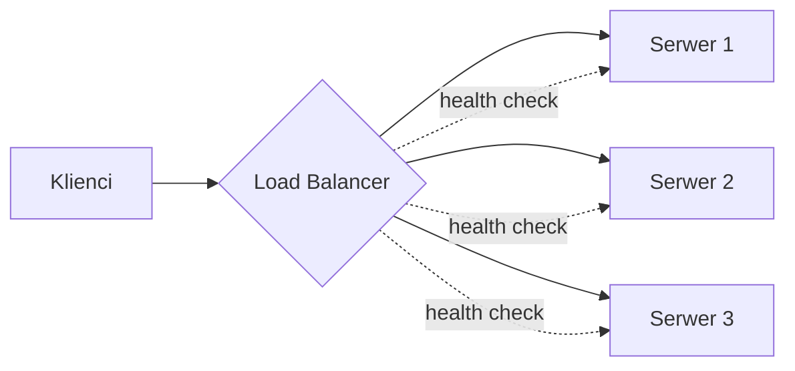

# Load Balancing

[← Indeks](../README.md)

## Definicja
Load balancer (LB) rozdziela przychodzący ruch pomiędzy wiele instancji backendu, zwiększając przepustowość, dostępność i umożliwiając skalowanie poziome.

## Warstwy
| Typ | Warstwa OSI | Cechy | Przykłady |
|-----|-------------|-------|-----------|
| L4 | TCP/UDP | Szybki, nie widzi treści HTTP | AWS NLB, HAProxy (tcp), IPVS |
| L7 | HTTP | Routing po ścieżce/nagłówkach, TLS termination, sticky sessions | Nginx, Envoy, AWS ALB |

## Algorytmy
- **Round Robin / Weighted RR** – prosty, równy podział (wagi dla różnych maszyn).
- **Least Connections / Least Response Time** – dobry przy nierównych żądaniach.
- **IP Hash / Consistent Hashing** – to samo ID trafia do tego samego węzła (cache locality, minimalne przetasowanie po zmianie liczby węzłów).
- **Power of Two Choices** – losuj 2 węzły, wybierz mniej obciążony; świetny kompromis.

## Kluczowe zagadnienia
- **Health checks** (aktywne i pasywne) i usuwanie niezdrowych węzłów.
- **Sticky sessions** vs usługi bezstanowe (preferuj bezstanowe, sesja w Redis/JWT).
- **SPOF**: sam LB musi być redundantny (active-passive, anycast, DNS).
- **Global LB**: GeoDNS, anycast – kierowanie do najbliższego regionu.
- Client-side LB (gRPC, Spring Cloud LoadBalancer) vs server-side.

## Pytania rekrutacyjne
- Jak zapewnić, by LB nie był SPOF?
- L4 vs L7 – kiedy co?
- Jak obsłużyć WebSockety i długie połączenia?

## Referencje
- [Nginx: HTTP Load Balancing](https://docs.nginx.com/nginx/admin-guide/load-balancer/http-load-balancer/)
- [Envoy: Load balancing](https://www.envoyproxy.io/docs/envoy/latest/intro/arch_overview/upstream/load_balancing/overview)
- [Mitzenmacher – Power of Two Choices](https://www.eecs.harvard.edu/~michaelm/postscripts/handbook2001.pdf)
- Powiązane: [Service Discovery](16-service-discovery.md), [API Gateway](06-api-gateway.md), [Skalowanie](20-horizontal-vs-vertical-scaling.md)
