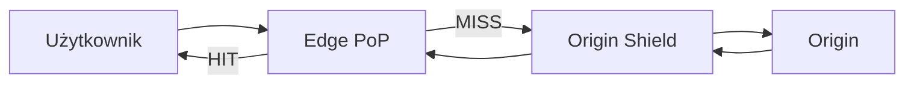

# CDN (Content Delivery Network)

[← Indeks](../README.md)

## Definicja
Globalnie rozproszona sieć serwerów brzegowych (edge/PoP), która cache'uje treści blisko użytkownika, zmniejszając opóźnienie i obciążenie origin.

## Pull vs Push
- **Pull (origin pull)** – CDN pobiera zasób przy pierwszym żądaniu; proste, domyślne.
- **Push** – wgrywasz pliki sam; sensowne dla rzadko zmienianych, dużych plików.

## Sterowanie cache
- Nagłówki: `Cache-Control: max-age, s-maxage, stale-while-revalidate`, `ETag`, `Vary`.
- **Fingerprinting** (`app.3f9a.js`) – nieskończony TTL + nowa nazwa po zmianie = brak potrzeby purge.
- Purge/invalidation po URL, tagu (surrogate keys).

## Zastosowania
Statyki, obrazy, wideo (HLS/DASH), cache API GET, ochrona DDoS/WAF, TLS termination, edge compute (Cloudflare Workers, Lambda@Edge).

## Kompromisy
- Koszt egress, świeżość danych, spójność wielu PoP, cache poisoning, personalizacja (klucz cache vs `Vary`/cookies).

## Referencje
- [Cloudflare: What is a CDN?](https://www.cloudflare.com/learning/cdn/what-is-a-cdn/)
- [MDN: HTTP caching](https://developer.mozilla.org/en-US/docs/Web/HTTP/Caching)
- Powiązane: [Caching](03-caching.md), [Cache Invalidation](04-cache-invalidation.md)
