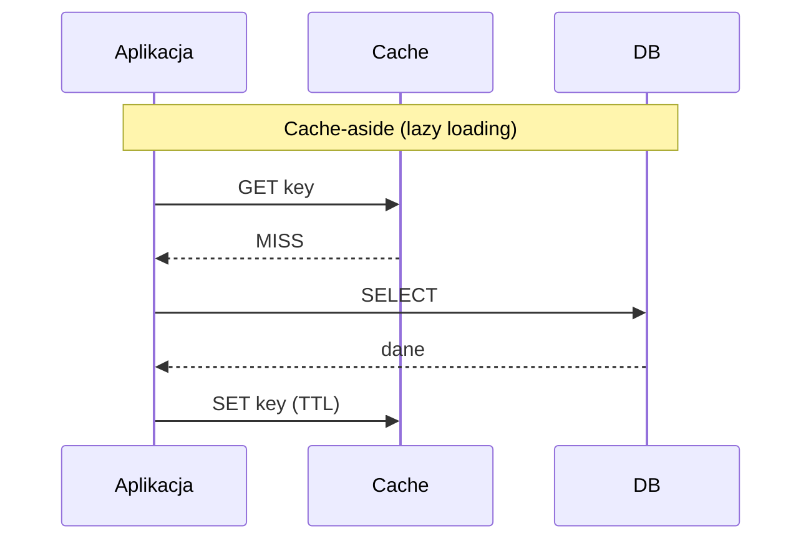

# Caching

[← Indeks](../README.md)

## Definicja
Przechowywanie wyników kosztownych operacji lub często czytanych danych w szybszej warstwie (RAM) w celu redukcji latencji i obciążenia źródła.

## Poziomy cache
Przeglądarka → CDN → API Gateway → cache aplikacji (Caffeine, lokalny) → cache rozproszony (Redis, Memcached) → cache DB (buffer pool).

## Strategie

| Strategia | Opis | Wada |
|-----------|------|------|
| Cache-aside | App ładuje i uzupełnia cache | Pierwszy odczyt wolny, ryzyko stale |
| Read-through | Cache sam ładuje z DB | Zależność od providera |
| Write-through | Zapis do cache i DB synchronicznie | Wolniejszy zapis |
| Write-behind | Zapis do cache, DB asynchronicznie | Ryzyko utraty danych |
| Write-around | Zapis tylko do DB | Miss po zapisie |

## Eviction
LRU, LFU, FIFO, TTL, W-TinyLFU (Caffeine).

## Problemy
- **Cache stampede / thundering herd** – wiele równoległych miss; rozwiązanie: single-flight/lock, jitter TTL, early refresh.
- **Cache penetration** – zapytania o nieistniejące klucze; Bloom filter, negative caching.
- **Hot key** – replikacja klucza, lokalny L1.
- Spójność – zob. [Cache Invalidation](04-cache-invalidation.md).

## Java / Spring
`@Cacheable`, `@CacheEvict`, Caffeine, Redis (Lettuce/Spring Data Redis).

## Referencje
- [Caffeine](https://github.com/ben-manes/caffeine)
- [Redis docs: caching patterns](https://redis.io/docs/latest/develop/use/client-side-caching/)
- [AWS: Caching best practices](https://aws.amazon.com/caching/best-practices/)
