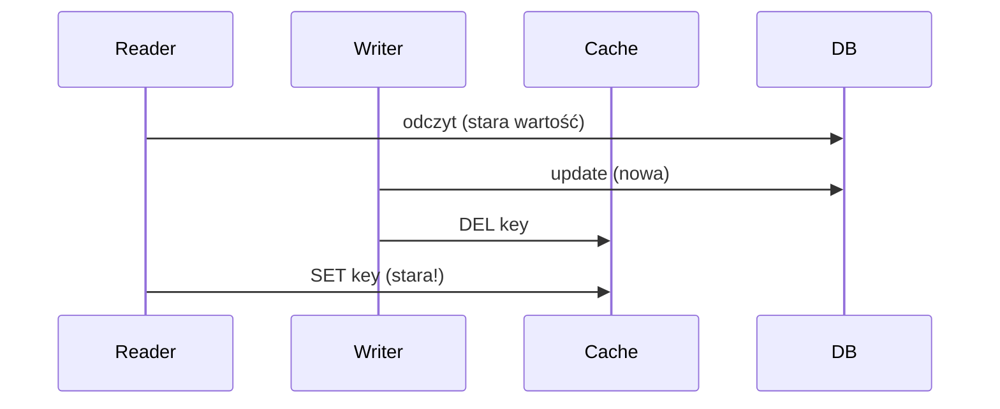

# Cache Invalidation

[← Indeks](../README.md)

> "There are only two hard things in Computer Science: cache invalidation and naming things." – Phil Karlton

## Problem
Cache przechowuje kopię danych; gdy źródło się zmienia, kopia staje się nieaktualna (stale). Trzeba zdecydować kiedy i jak ją unieważnić.

## Techniki
| Technika | Jak działa | Zaleta | Wada |
|----------|-----------|--------|------|
| TTL | Wygasa po czasie | Prosta | Okno nieaktualności |
| Explicit delete on write | Po zapisie `DEL key` | Świeże dane | Race conditions |
| Write-through | Aktualizacja cache przy zapisie | Spójność | Koszt zapisu |
| Event-driven | Zdarzenie (Kafka/CDC/Debezium) czyści cache | Skalowalne, decoupled | Złożoność |
| Versioned keys | `user:42:v7` | Brak purge | Śmieci w cache |
| Stale-while-revalidate | Serwuj stare, odśwież w tle | Niska latencja | Chwilowo stale |

## Klasyczny race condition

Mitygacje: krótki TTL, versioning, delayed double delete, CDC jako źródło invalidacji.

## Wzorce
- **Cache stampede**: lock, probabilistic early expiration, jitter.
- Invalidation po tagach (surrogate keys na CDN).
- Spring: `@CacheEvict`, `@CachePut`.

## Referencje
- [Facebook: Scaling Memcache (paper)](https://research.facebook.com/publications/scaling-memcache-at-facebook/)
- [Debezium](https://debezium.io/)
- Powiązane: [Caching](03-caching.md), [Eventual Consistency](18-eventual-consistency.md)
