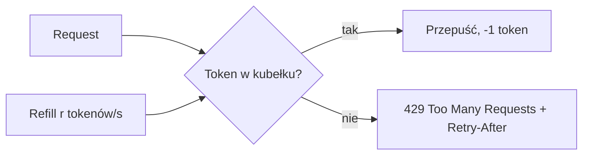

# Rate Limiting

[← Indeks](../README.md)

## Cel
Ochrona usług przed przeciążeniem, nadużyciem i DDoS; sprawiedliwy podział zasobów (multi-tenant); kontrola kosztów.

## Algorytmy
| Algorytm | Idea | Uwagi |
|----------|------|-------|
| Fixed window | Licznik na okno (np. 100/min) | Burst na granicy okien |
| Sliding window log | Znaczniki czasu żądań | Dokładny, kosztowny pamięciowo |
| Sliding window counter | Ważona suma dwóch okien | Dobry kompromis |
| Token bucket | Kubełek tokenów uzupełniany z stałą prędkością | Pozwala na burst; najpopularniejszy |
| Leaky bucket | Stała prędkość wypływu (kolejka) | Wygładza ruch |

## Implementacja rozproszona
- Stan w Redis (INCR + EXPIRE, skrypt Lua dla atomowości).
- Limity per: user, API key, IP, endpoint, tenant.
- Gdzie: API Gateway / sidecar / biblioteka (Bucket4j, Resilience4j RateLimiter).
- Nagłówki: `X-RateLimit-Limit`, `X-RateLimit-Remaining`, `Retry-After`, status **429**.

## Kompromisy
Dokładność vs latencja (lokalne liczniki z synchronizacją), fail-open vs fail-closed gdy Redis niedostępny.

## Referencje
- [Stripe: Scaling your API with rate limiters](https://stripe.com/blog/rate-limiters)
- [Bucket4j](https://bucket4j.com/)
- Powiązane: [API Gateway](06-api-gateway.md), [Fault Tolerance](14-fault-tolerance.md)
