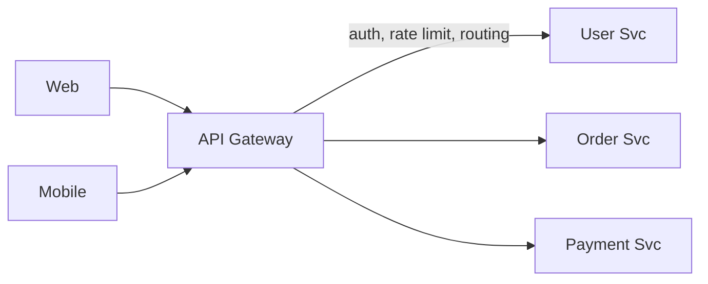

# API Gateway

[← Indeks](../README.md)

## Definicja
Pojedynczy punkt wejścia do systemu mikroserwisów. Przyjmuje żądania klientów i kieruje je do właściwych usług, realizując zagadnienia przekrojowe.

## Odpowiedzialności
Routing, uwierzytelnianie/autoryzacja (JWT, OAuth2), rate limiting, TLS termination, cache, transformacja protokołów (REST↔gRPC), agregacja odpowiedzi, logowanie/tracing, wersjonowanie API, circuit breaking.

## Wzorce
- **BFF (Backend for Frontend)** – osobna brama per typ klienta.
- **API Composition** – brama składa dane z wielu usług.
- Gateway vs Service Mesh: gateway = ruch północ-południe, mesh = wschód-zachód.

## Ryzyka
SPOF i wąskie gardło (skaluj poziomo), "god gateway" z logiką biznesową (unikaj), dodatkowy hop latencji.

## Technologie
Spring Cloud Gateway, Kong, NGINX, Envoy, AWS API Gateway, Apigee.

## Referencje
- [microservices.io: API Gateway](https://microservices.io/patterns/apigateway.html)
- [Spring Cloud Gateway](https://spring.io/projects/spring-cloud-gateway)
- Powiązane: [Rate Limiting](05-rate-limiting.md), [Load Balancing](01-load-balancing.md)
