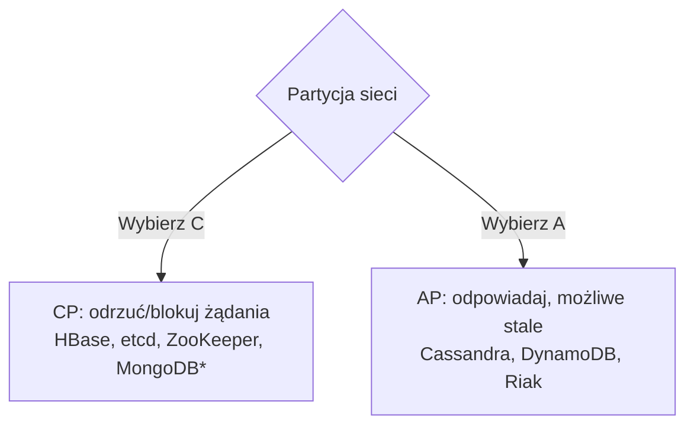

# CAP Theorem

[← Indeks](../README.md)

## Definicja
(Brewer, 2000; dowód Gilbert & Lynch, 2002) Rozproszony system danych nie może jednocześnie zagwarantować:
- **C**onsistency – każdy odczyt widzi ostatni zapis (linearizability),
- **A**vailability – każde żądanie do działającego węzła dostaje odpowiedź,
- **P**artition tolerance – działanie mimo utraty komunikacji między węzłami.

Partycje w sieci się zdarzają, więc realny wybór brzmi: **podczas partycji – C czy A?**

## PACELC
Rozszerzenie (Abadi): jeśli **P**artycja → A albo C; **E**lse (normalnie) → **L**atency albo **C**onsistency. Pokazuje, że kompromis istnieje także bez awarii (replikacja synchroniczna = wolniej, ale spójnie).

## Częste nieporozumienia
- To nie "wybierz 2 z 3" na stałe; CA w systemie rozproszonym jest iluzją.
- C w CAP ≠ C w ACID.
- Wybór może być per operację (np. koszyk AP, płatność CP).

## Referencje
- [Brewer: CAP Twelve Years Later](https://www.infoq.com/articles/cap-twelve-years-later-how-the-rules-have-changed/)
- [Kleppmann: Please stop calling databases CP or AP](https://martin.kleppmann.com/2015/05/11/please-stop-calling-databases-cp-or-ap.html)
- Powiązane: [Consistency Models](17-consistency-models.md), [Eventual Consistency](18-eventual-consistency.md)
