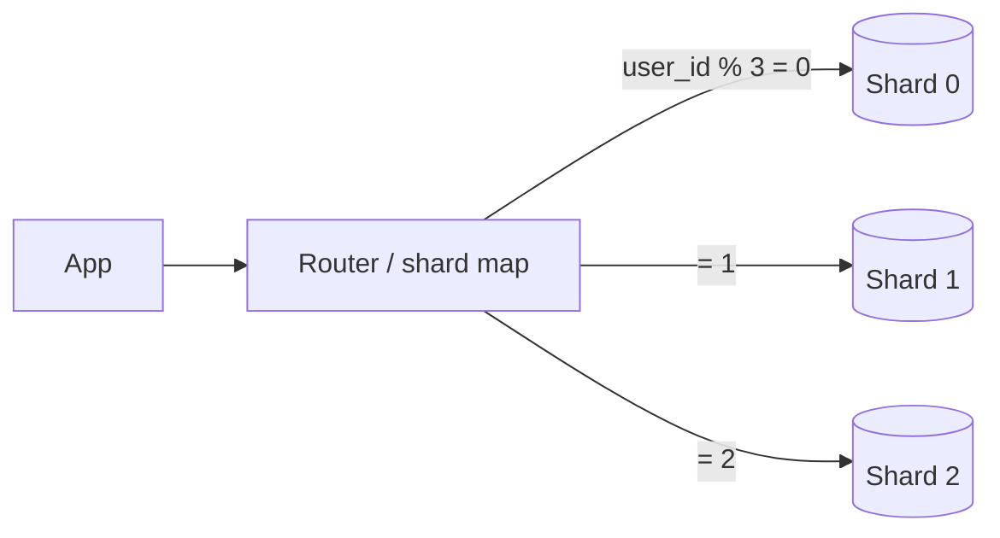

# Sharding

[← Indeks](../README.md)

## Definicja
Sharding to poziome partycjonowanie danych na wiele niezależnych węzłów (shardów), z których każdy przechowuje podzbiór rekordów. Pozwala skalować zapis i rozmiar danych ponad możliwości jednej maszyny.

## Strategie
| Strategia | Opis | Wady |
|-----------|------|------|
| Range | Zakresy klucza | Hot spoty (np. rosnące ID) |
| Hash | `hash(key) % N` | Resharding przetasowuje wszystko |
| Consistent hashing | Pierścień + virtual nodes | Złożoność, ale mało ruchu przy zmianie N |
| Directory / lookup | Tabela mapowania | Dodatkowy SPOF |
| Geo | Wg regionu | Nierówny rozkład |

## Wyzwania
- Wybór **shard key** (wysoka kardynalność, równomierny rozkład, zgodny z zapytaniami).
- Zapytania cross-shard i JOIN-y, transakcje rozproszone ([zob.](19-distributed-transactions.md)).
- Hot shards / celebrity problem.
- Resharding online, unikalne ID (Snowflake, UUIDv7).

## Technologie
Vitess, Citus, MongoDB sharding, Cassandra, DynamoDB, CockroachDB (auto).

## Referencje
- [Karger et al.: Consistent Hashing](https://www.cs.princeton.edu/courses/archive/fall09/cos518/papers/chash.pdf)
- [Vitess](https://vitess.io/docs/)
- Powiązane: [Partitioning](10-partitioning.md), [Database Scaling](15-database-scaling.md), [Replication](09-replication.md)
