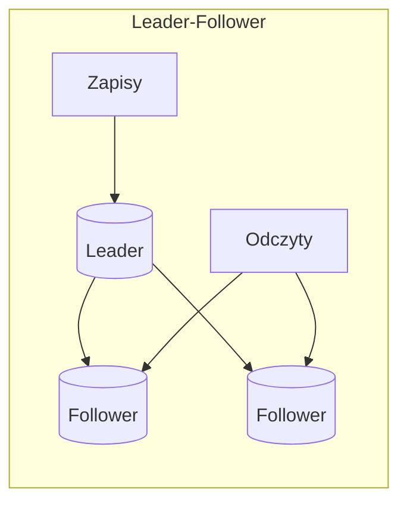

# Replication

[← Indeks](../README.md)

## Definicja
Utrzymywanie kopii tych samych danych na wielu węzłach – dla wysokiej dostępności, skalowania odczytów i niskiej latencji geograficznej.

## Modele

| Model | Opis | Przykłady |
|-------|------|-----------|
| Single-leader | Zapisy tylko do lidera | PostgreSQL, MySQL |
| Multi-leader | Wielu liderów (multi-region), konflikty zapisów | Active-active DB |
| Leaderless (quorum) | Zapis do W, odczyt z R węzłów; `W+R>N` | Cassandra, Dynamo |

## Sync vs Async
- **Synchroniczna** – brak utraty danych, wyższa latencja, spadek dostępności.
- **Asynchroniczna** – szybka, ale replication lag i ryzyko utraty przy awarii lidera.
- **Semi-sync** – jedna replika synchroniczna.

## Problemy
- Replication lag → read-your-writes, monotonic reads ([Eventual Consistency](18-eventual-consistency.md)).
- Failover i split-brain ([Leader Election](22-leader-election.md)).
- Rozwiązywanie konfliktów: LWW, vector clocks, CRDT.
- Mechanizmy: WAL shipping, logical replication, CDC.

## Referencje
- DDIA, rozdz. 5 "Replication"
- [PostgreSQL: High Availability](https://www.postgresql.org/docs/current/high-availability.html)
- Powiązane: [Sharding](08-sharding.md), [CAP](07-cap-theorem.md)
