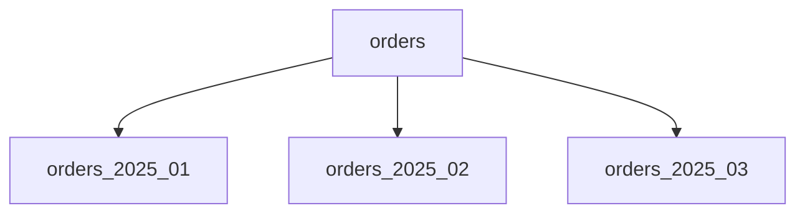

# Partitioning

[← Indeks](../README.md)

## Definicja
Podział dużego zbioru danych (tabeli/topicu) na mniejsze części (partycje) w celu wydajności, zarządzalności i skalowania. Sharding to partycjonowanie rozproszone na wiele maszyn.

## Rodzaje
- **Pionowe** – podział kolumn (np. rzadko używane BLOB-y do osobnej tabeli).
- **Poziome** – podział wierszy: **range** (po dacie), **hash**, **list** (po regionie).
- **Funkcjonalne** – dane per domena/usługa (database per service).

## Korzyści
Partition pruning (skanuje się tylko potrzebne partycje), szybkie usuwanie starych danych (`DROP PARTITION`), mniejsze indeksy, równoległość.

## Pułapki
Złe klucze → skos danych (skew), zapytania bez klucza partycji skanują wszystko, unikalność globalna, rebalancing.

## W praktyce
- PostgreSQL: `PARTITION BY RANGE (created_at)`.
- Kafka: partycje topicu = jednostka równoległości; klucz gwarantuje kolejność w partycji.
- Secondary indexes: lokalne (document-partitioned) vs globalne (term-partitioned).

## Referencje
- DDIA, rozdz. 6 "Partitioning"
- [PostgreSQL Partitioning](https://www.postgresql.org/docs/current/ddl-partitioning.html)
- Powiązane: [Sharding](08-sharding.md), [Queues](11-queues.md)
