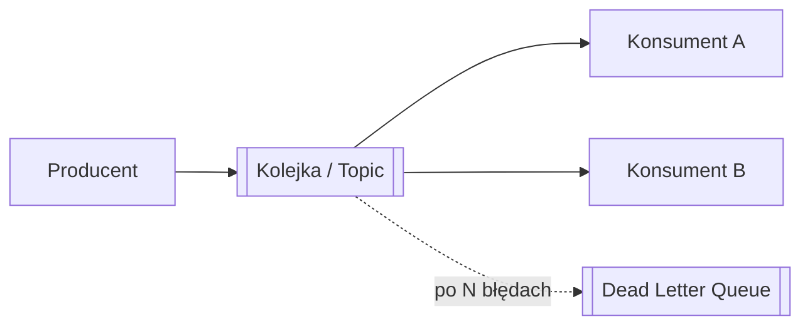

# Queues

[← Indeks](../README.md)

## Definicja
Kolejki/brokery wiadomości umożliwiają asynchroniczną komunikację: producent publikuje, konsument przetwarza później. Odsprzęgają usługi, wygładzają piki (load leveling) i zwiększają odporność.

## Modele
- **Point-to-point (queue)** – każda wiadomość do jednego konsumenta (RabbitMQ, SQS).
- **Pub/Sub (topic)** – do wielu subskrybentów (Kafka, SNS, Pulsar).
- **Log-based (Kafka)** – trwały, odtwarzalny log, offsety, consumer groups.

## Gwarancje dostarczenia
| Gwarancja | Znaczenie |
|-----------|-----------|
| At-most-once | Może zginąć, bez duplikatów |
| At-least-once | Brak utraty, możliwe duplikaty → konsument [idempotentny](23-idempotency-and-data-latency.md) |
| Exactly-once | Efektywnie: at-least-once + idempotencja/transakcje (Kafka EOS) |

## Wzorce
DLQ, retry z backoffem, **Outbox**, backpressure, competing consumers, priority queue, kolejność per klucz/partycja.

## Kiedy używać
Zadania w tle, integracja usług, event-driven, buforowanie zapisów, fan-out. Uwaga na spójność ostateczną i monitoring lagu.

## Referencje
- [Kafka docs](https://kafka.apache.org/documentation/)
- [Jay Kreps: The Log](https://engineering.linkedin.com/distributed-systems/log-what-every-software-engineer-should-know-about-real-time-datas-unifying)
- [Enterprise Integration Patterns](https://www.enterpriseintegrationpatterns.com/)
- Powiązane: [Distributed Transactions](19-distributed-transactions.md)
