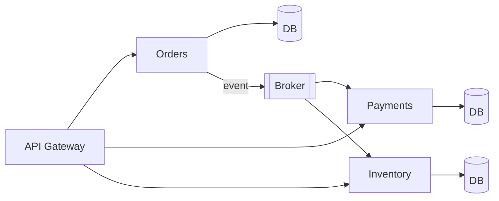

# Microservices

[← Indeks](../README.md)

## Definicja
Styl architektury, w którym aplikacja składa się z małych, autonomicznych usług zbudowanych wokół zdolności biznesowych (bounded contexts), wdrażanych i skalowanych niezależnie, komunikujących się przez sieć.

## Zasady
Single responsibility, **database per service**, niezależny deploy, smart endpoints & dumb pipes, design for failure, automatyzacja (CI/CD), obserwowalność.

## Wzorce
API Gateway, Service Discovery, Circuit Breaker, Saga, Outbox, CQRS, Event Sourcing, Strangler Fig, Sidecar/Service Mesh, Config Server.

## Komunikacja
Synchroniczna (REST, gRPC) vs asynchroniczna (zdarzenia/kolejki). Preferuj async tam, gdzie to możliwe, by ograniczyć coupling czasowy.

## Koszty
Złożoność operacyjna, sieć (latencja, awarie), spójność danych, testowanie end-to-end, distributed tracing, wersjonowanie kontraktów.

## Narzędzia (Java)
Spring Boot/Cloud, Resilience4j, OpenTelemetry, Kubernetes, Istio/Linkerd, Kafka.

## Referencje
- [Fowler: Microservices](https://martinfowler.com/articles/microservices.html)
- [microservices.io](https://microservices.io/patterns/)
- Sam Newman, *Building Microservices*
- Powiązane: [vs Monolit](13-microservices-vs-monoliths.md), [Service Discovery](16-service-discovery.md), [Distributed Transactions](19-distributed-transactions.md)
