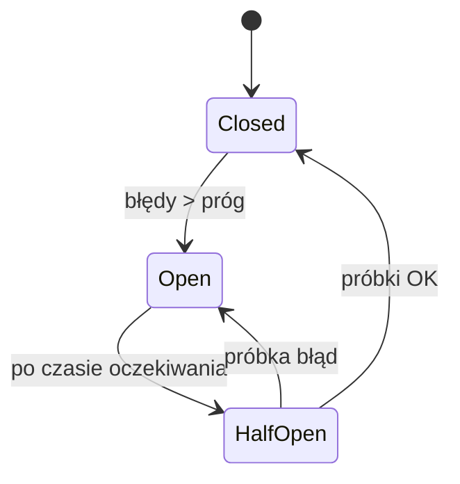

# Fault Tolerance

[← Indeks](../README.md)

## Definicja
Zdolność systemu do dalszego działania (ewentualnie w trybie ograniczonym) mimo awarii komponentów. Zakłada, że awarie są normą ("everything fails").

## Wzorce
| Wzorzec | Opis |
|---------|------|
| Redundancja | Wiele instancji/AZ/regionów, brak SPOF |
| Timeout | Każde wywołanie sieciowe ma limit czasu |
| Retry + exponential backoff + jitter | Powtórki tylko dla operacji [idempotentnych](23-idempotency-and-data-latency.md) |
| Circuit Breaker | Po serii błędów otwiera obwód i szybko zawodzi |
| Bulkhead | Izolacja pul zasobów, awaria nie rozlewa się |
| Fallback / graceful degradation | Wartość domyślna, cache, okrojona funkcja |
| Load shedding / backpressure | Odrzucanie nadmiaru zamiast zapaści |
| Health checks + auto-healing | K8s liveness/readiness |

## Miary
Availability (99.9% ≈ 8.76 h/rok przestoju, 99.99% ≈ 52 min), SLA/SLO/SLI, RTO, RPO, MTTR/MTBF.

## Testowanie
Chaos engineering (Chaos Monkey, Litmus), game days, testy failover.

## Referencje
- [Resilience4j](https://resilience4j.readme.io/)
- [AWS: Timeouts, retries and backoff with jitter](https://aws.amazon.com/builders-library/timeouts-retries-and-backoff-with-jitter/)
- Michael Nygard, *Release It!*
- Powiązane: [Replication](09-replication.md), [Rate Limiting](05-rate-limiting.md)
