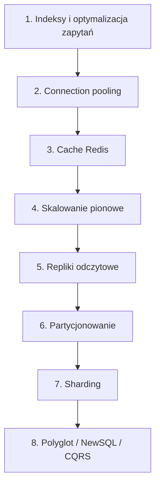

# Database Scaling

[← Indeks](../README.md)

## Drabina skalowania (od najtańszego)

## Techniki
- **Optymalizacja**: `EXPLAIN`, indeksy (B-tree, composite, covering), unikanie N+1, denormalizacja.
- **Connection pool**: HikariCP, PgBouncer.
- **Read replicas**: odczyty na replikach (uwaga na lag).
- **Cache**: [Caching](03-caching.md).
- **Sharding/partitioning**: [Sharding](08-sharding.md), [Partitioning](10-partitioning.md).
- **CQRS**: osobny model odczytu/zapisu.
- **Archiwizacja** zimnych danych.

## SQL vs NoSQL
| Typ | Przykłady | Użycie |
|-----|-----------|--------|
| Relacyjna | PostgreSQL, MySQL | Transakcje, złożone zapytania |
| Key-Value | Redis, DynamoDB | Niski latency, prosty dostęp |
| Dokumentowa | MongoDB | Elastyczny schemat |
| Wide-column | Cassandra | Ogromny zapis, time series |
| Graf | Neo4j | Relacje |
| NewSQL | CockroachDB, Spanner | SQL + skalowanie poziome |

## Zasada
Zmierz wąskie gardło (zapis vs odczyt, CPU vs IO) przed wyborem techniki.

## Referencje
- DDIA, rozdz. 3, 5, 6
- [Use The Index, Luke](https://use-the-index-luke.com/)
- Powiązane: [Replication](09-replication.md), [Skalowanie H/V](20-horizontal-vs-vertical-scaling.md)
