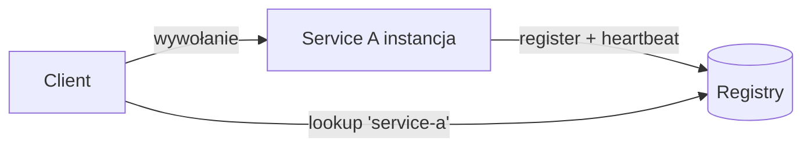

# Service Discovery

[← Indeks](../README.md)

## Problem
W środowisku dynamicznym (autoscaling, K8s) adresy IP instancji ciągle się zmieniają. Service discovery pozwala usługom znajdować się nawzajem bez twardych adresów.

## Modele
- **Client-side discovery** – klient pyta rejestr i sam balansuje (Eureka + Spring Cloud LoadBalancer).
- **Server-side discovery** – LB/router pyta rejestr (AWS ALB, K8s Service + kube-proxy).
- **DNS-based** – K8s CoreDNS (`svc.namespace.svc.cluster.local`).

## Rejestracja
Self-registration vs third-party registration (platforma rejestruje sama). Heartbeat + TTL, deregistracja przy zamknięciu, health checks.

## Technologie
Consul, Eureka, etcd, ZooKeeper, Kubernetes Services, Istio/Envoy (xDS).

## Uwagi
Rejestr to krytyczny komponent (HA, często CP: Raft/etcd); cache po stronie klienta na wypadek niedostępności; stale entries.

## Referencje
- [microservices.io: Service Discovery](https://microservices.io/patterns/client-side-discovery.html)
- [Consul docs](https://developer.hashicorp.com/consul/docs)
- [Kubernetes: Service](https://kubernetes.io/docs/concepts/services-networking/service/)
- Powiązane: [Load Balancing](01-load-balancing.md), [Leader Election](22-leader-election.md)
