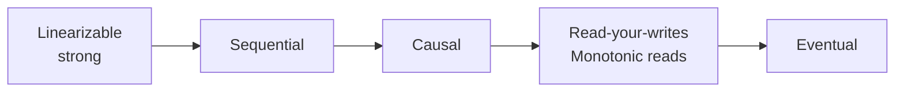

# Consistency Models

[← Indeks](../README.md)

## Definicja
Model spójności określa, jakie wartości odczyt może zwrócić po zapisach w systemie z wieloma replikami/współbieżnością. Silniejszy model = prostsze rozumowanie, ale większy koszt latencji i mniejsza dostępność.

## Spektrum (od najsilniejszego)

| Model | Gwarancja |
|-------|-----------|
| Linearizability | Operacje wyglądają, jakby wykonały się atomowo w czasie rzeczywistym |
| Sequential | Wszyscy widzą ten sam porządek, niekoniecznie zgodny z czasem rzeczywistym |
| Causal | Przyczyna widoczna przed skutkiem |
| Read-your-writes | Widzisz własne zapisy |
| Monotonic reads | Nie cofasz się w czasie |
| Eventual | Repliki w końcu się zbiegną |

## Transakcyjne poziomy izolacji (ACID)
Read Uncommitted → Read Committed → Repeatable Read → Snapshot Isolation → Serializable. Anomalie: dirty read, non-repeatable read, phantom, write skew.

## Osiąganie
Kworum (R+W>N), konsensus (Raft/Paxos), single leader, vector clocks, hybrid logical clocks, TrueTime (Spanner).

## Referencje
- [Jepsen: Consistency Models map](https://jepsen.io/consistency)
- DDIA, rozdz. 7 i 9
- Powiązane: [CAP](07-cap-theorem.md), [Eventual Consistency](18-eventual-consistency.md)
