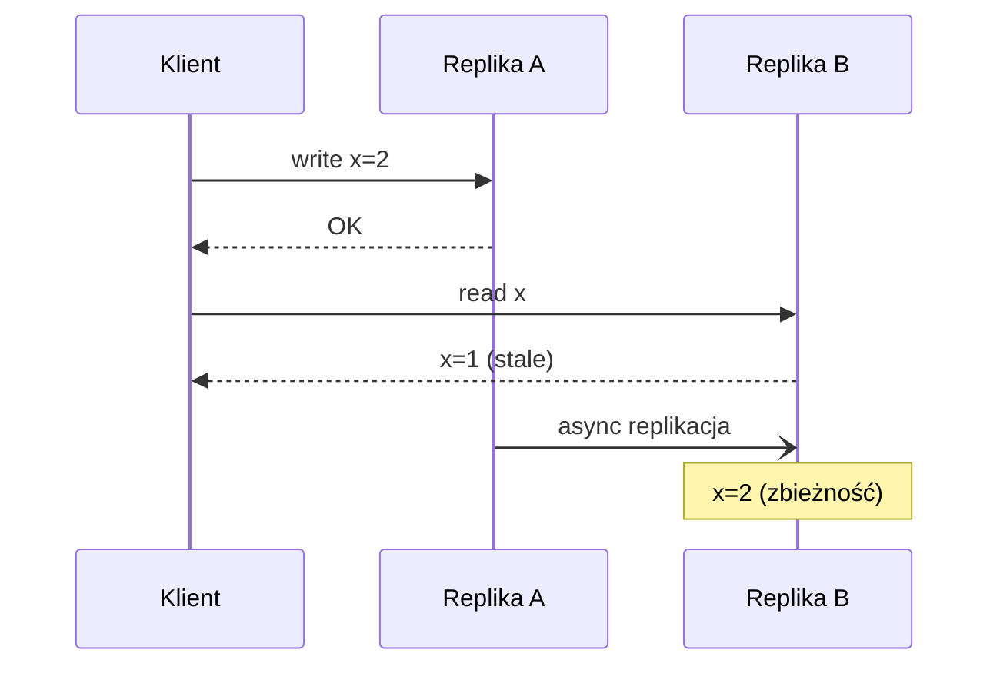

# Eventual Consistency

[← Indeks](../README.md)

## Definicja
Jeśli nie pojawią się nowe zapisy, wszystkie repliki w końcu osiągną ten sam stan. W międzyczasie odczyty mogą zwracać nieaktualne dane. Wybierana dla dostępności i niskiej latencji (AP).

## Gwarancje sesyjne (łagodzą anomalie)
Read-your-writes, monotonic reads, monotonic writes, writes-follow-reads.

## Rozwiązywanie konfliktów
- **LWW** (last-write-wins) – proste, gubi dane.
- **Vector clocks** – wykrywają współbieżność.
- **CRDT** – struktury łączące się bez konfliktów (liczniki, zbiory).
- Merge na poziomie aplikacji.

## Mechanizmy zbieżności
Anti-entropy, Merkle trees, read repair, hinted handoff, gossip.

## W architekturze
Sagi, event-driven między mikroserwisami, CQRS read modele, cache. Projektuj UI/UX z myślą o opóźnieniu (optymistyczne UI), użyj idempotencji.

## Referencje
- [Werner Vogels: Eventually Consistent](https://www.allthingsdistributed.com/2008/12/eventually_consistent.html)
- [Dynamo paper](https://www.allthingsdistributed.com/files/amazon-dynamo-sosp2007.pdf)
- [CRDT.tech](https://crdt.tech/)
- Powiązane: [Consistency Models](17-consistency-models.md), [CAP](07-cap-theorem.md)
