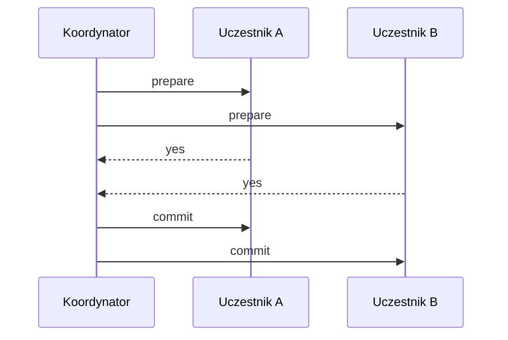
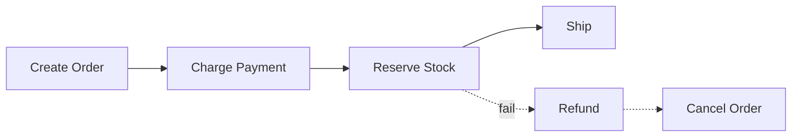

# Distributed Transactions

[← Indeks](../README.md)

## Problem
Operacja obejmuje wiele usług/baz (np. zamówienie + płatność + magazyn), a ACID nie działa między nimi automatycznie.

## 2PC (Two-Phase Commit)

Zalety: atomowość. Wady: blokowanie, koordynator jako SPOF, słabe skalowanie. (XA, JTA)

## Saga
Sekwencja lokalnych transakcji + **akcje kompensujące** przy porażce.

- **Choreografia** – usługi reagują na zdarzenia (luźne sprzężenie, trudniejsze śledzenie).
- **Orkiestracja** – centralny orkiestrator (Temporal, Camunda, Axon).

## Inne wzorce
- **Transactional Outbox** – zapis zdarzenia w tej samej transakcji DB co zmiana stanu, osobny relay publikuje do brokera (+ CDC/Debezium).
- **Inbox / idempotent consumer**.
- **TCC** (Try-Confirm-Cancel).
- Spanner/CockroachDB – prawdziwe rozproszone ACID kosztem latencji.

## Zasada kciuka
Unikaj transakcji rozproszonych przez dobre granice usług; gdy konieczne – Saga + Outbox + [idempotencja](23-idempotency-and-data-latency.md).

## Referencje
- [microservices.io: Saga](https://microservices.io/patterns/data/saga.html)
- [microservices.io: Transactional Outbox](https://microservices.io/patterns/data/transactional-outbox.html)
- [Temporal](https://docs.temporal.io/)
- Powiązane: [Queues](11-queues.md), [Eventual Consistency](18-eventual-consistency.md)
