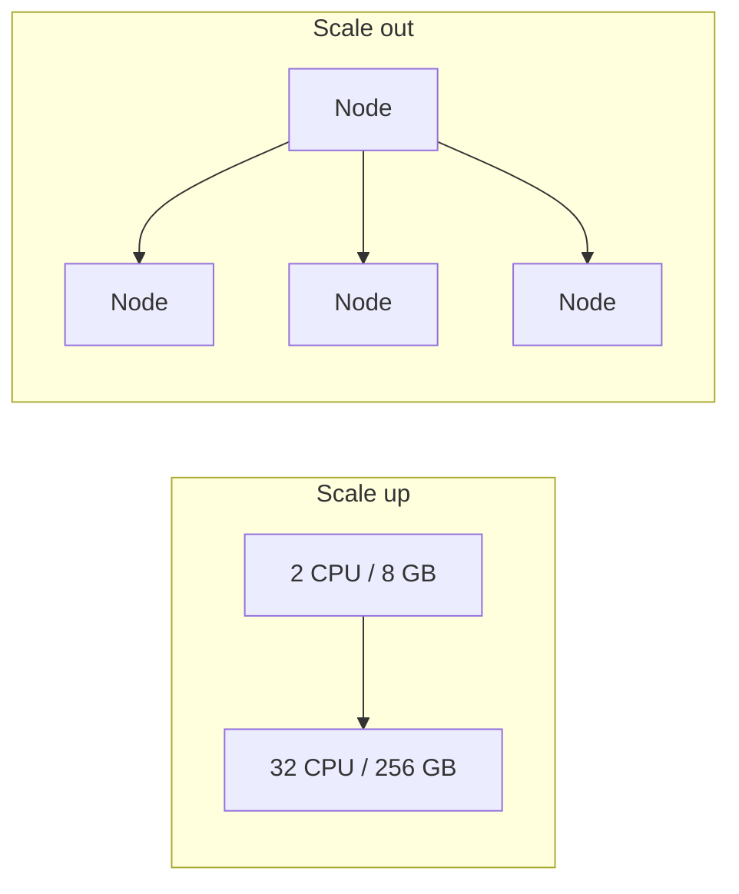

# Horizontal vs Vertical Scaling

[← Indeks](../README.md)

| | Vertical (scale up) | Horizontal (scale out) |
|--|--------------------|------------------------|
| Idea | Mocniejsza maszyna | Więcej maszyn |
| Złożoność | Niska | Wysoka (LB, dane, spójność) |
| Limit | Sufit sprzętowy, rosnący koszt | Praktycznie brak |
| Dostępność | SPOF | Redundancja |
| Downtime przy skalowaniu | Często tak | Zwykle nie |
| Wymaga | Nic | Bezstanowości, LB, partycjonowania danych |

## Jak skalować poziomo
- Usługi **bezstanowe** (sesja w Redis/JWT) + [Load Balancer](01-load-balancing.md).
- Autoscaling (K8s HPA, AWS ASG) na CPU/RPS/lag kolejki.
- Dane: [replikacja](09-replication.md), [sharding](08-sharding.md).

## Praktyka
Zacznij od vertical (prosto i tanio), przejdź na horizontal, gdy zbliżasz się do limitów lub potrzebujesz HA. Bazy danych skaluje się trudniej niż warstwę aplikacji. Prawo Amdahla ogranicza zysk z równoległości.

## Referencje
- [AWS Well-Architected: Reliability](https://docs.aws.amazon.com/wellarchitected/latest/reliability-pillar/welcome.html)
- [Twelve-Factor App: Processes](https://12factor.net/processes)
- Powiązane: [Database Scaling](15-database-scaling.md)
