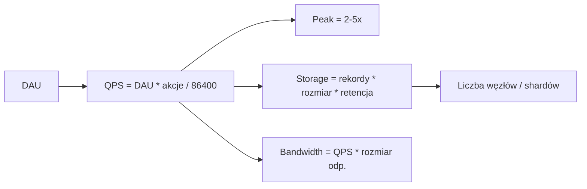

# Back of the Envelope Estimation

[← Indeks](../README.md)

## Cel
Szybkie, przybliżone szacunki (rząd wielkości) QPS, storage, bandwidth i liczby serwerów, aby zweryfikować wykonalność projektu i wybrać architekturę.

## Liczby do zapamiętania
| Operacja | Czas |
|----------|------|
| L1 cache | ~1 ns |
| RAM | ~100 ns |
| SSD random read | ~100 µs |
| Odczyt 1 MB z RAM | ~10 µs–250 µs |
| Roundtrip w DC | ~0.5 ms |
| Dysk HDD seek | ~10 ms |
| Roundtrip międzykontynentalny | ~150 ms |

Potęgi: 2^10 ≈ 1 tys., 2^20 ≈ 1 mln, 2^30 ≈ 1 mld. 1 doba ≈ 86 400 s ≈ 10^5 s. 1 mln/dobę ≈ 12 QPS.

## Schemat

## Przykład: skracacz URL
- 100 mln nowych URL/miesiąc → ~40 zapisów/s; odczyty 100:1 → ~4 000 QPS.
- 500 B/rekord × 100 mln × 12 × 5 lat = ~3 TB → mieści się w jednym klastrze z shardingiem/replikami.
- Odczyty z cache (80/20) → kilkaset QPS do DB.

## Wskazówki
Zaokrąglaj, zapisuj założenia, uwzględnij replikację (×3) i peak, sprawdź wiarygodność wyniku.

## Referencje
- [Latency Numbers Every Programmer Should Know](https://gist.github.com/jboner/2841832)
- Alex Xu, *System Design Interview*, rozdz. 2
- Powiązane: [Caching](03-caching.md), [Skalowanie](20-horizontal-vs-vertical-scaling.md)
