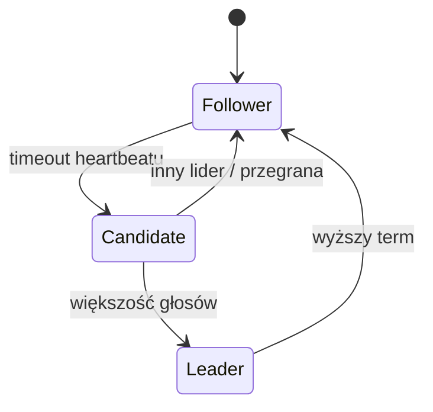

# Leader Election

[← Indeks](../README.md)

## Definicja
Proces wyboru jednego węzła (lidera) spośród grupy, który koordynuje pracę (zapisy, harmonogramy, metadane). Gdy lider padnie, wybierany jest nowy.

(Schemat stanów algorytmu Raft.)

## Algorytmy i narzędzia
- **Raft** – zrozumiały konsensus (etcd, Consul, CockroachDB, Kafka KRaft).
- **Paxos / Multi-Paxos**, **ZAB** (ZooKeeper).
- **Bully**, **Ring** – prostsze algorytmy akademickie.
- **Lease/lock w zewnętrznym magazynie**: ZooKeeper ephemeral nodes, etcd lease, Redis (Redlock – kontrowersyjny), K8s Lease, Spring Integration `LockRegistry`, ShedLock.

## Problemy
- **Split-brain** – dwóch liderów; rozwiązanie: kworum (większość), epoki/terms, **fencing tokens**.
- Zegary i pauzy GC – lease może wygasnąć, gdy lider "myśli", że nadal rządzi.
- Dobór timeoutów (szybki failover vs fałszywe alarmy).

## Zastosowania
Replikacja single-leader, kontroler partycji, singleton jobs (scheduler), koordynacja klastra.

## Referencje
- [Raft visualization](https://raft.github.io/)
- [Kleppmann: How to do distributed locking](https://martin.kleppmann.com/2016/02/08/how-to-do-distributed-locking.html)
- [In Search of an Understandable Consensus Algorithm (Raft paper)](https://raft.github.io/raft.pdf)
- Powiązane: [Replication](09-replication.md), [Service Discovery](16-service-discovery.md)
