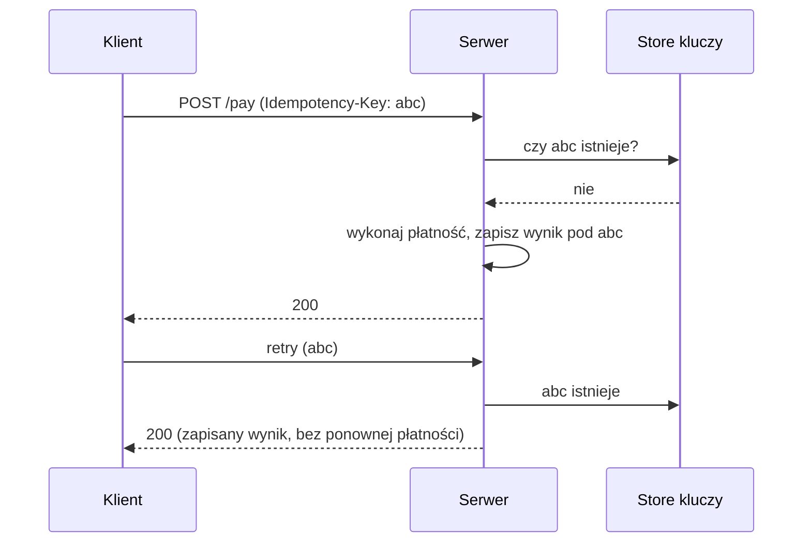

# Idempotency and Data Latency

[← Indeks](../README.md)

> Ostatnia pozycja na zrzucie była częściowo ucięta ("Idempotency and Data Latency…"); opisuję oba tematy.

## Idempotencja
Operacja jest idempotentna, jeśli wielokrotne wykonanie daje taki sam efekt jak jednokrotne. Kluczowa przy retry, at-least-once delivery i timeoutach (nie wiesz, czy żądanie się powiodło).

- Naturalnie idempotentne: `PUT`, `DELETE`, `SET x=5`. Nieidempotentne: `POST /payments`, `x = x+1`.
- **Idempotency key** – klient wysyła unikalny klucz; serwer zapisuje wynik i zwraca go przy powtórce.

Implementacja: unikalny constraint w DB (`INSERT ... ON CONFLICT DO NOTHING`), tabela przetworzonych `messageId` (idempotent consumer), wersjonowanie/optimistic locking, deduplikacja w Kafka (idempotent producer).

## Data Latency
Opóźnienie między zmianą danych a jej widocznością dla odbiorców (replication lag, opóźnienie cache, przetwarzanie strumieniowe, ETL). Może też oznaczać opóźnienie dostępu do danych (zob. [estymacje](21-back-of-the-envelope-estimation.md)).

Źródła: asynchroniczna replikacja, TTL cache, kolejki, batch processing, CDC.
Mitygacje: odczyt z lidera dla krytycznych ścieżek, read-your-writes (sticky routing/token wersji), krótsze TTL, push invalidation, monitorowanie lagu, SLO na świeżość danych.

## Referencje
- [Stripe: Idempotent requests](https://docs.stripe.com/api/idempotent_requests)
- [Brandur: Implementing Stripe-like idempotency keys in Postgres](https://brandur.org/idempotency-keys)
- IETF draft: The Idempotency-Key HTTP Header
- Powiązane: [Queues](11-queues.md), [Eventual Consistency](18-eventual-consistency.md), [Fault Tolerance](14-fault-tolerance.md)
